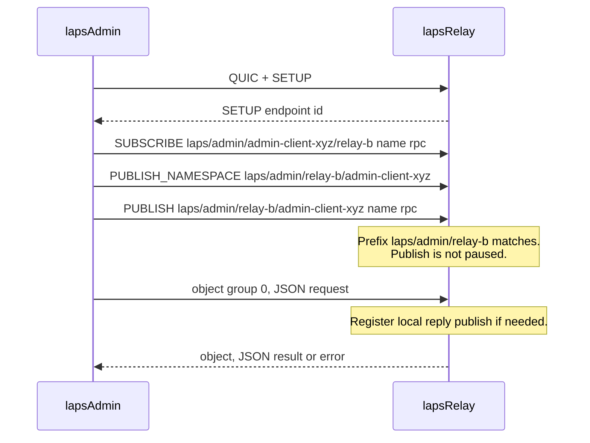
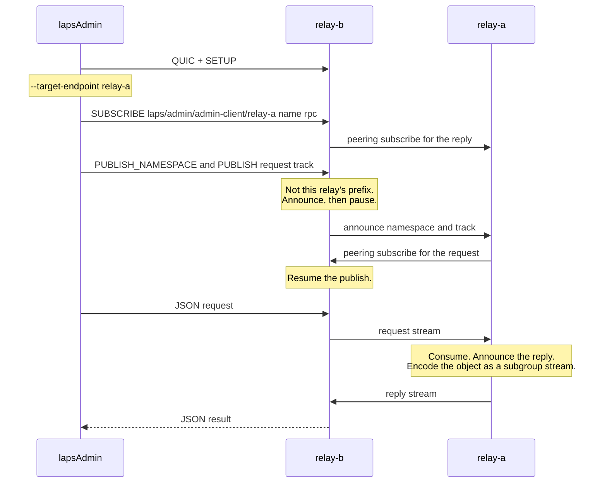

# LAPS Admin API

LAPS exposes a runtime admin API over MoQ publish and subscribe tracks. An admin client publishes a JSON request to the relay and subscribes to a JSON reply on a second track. `state` reports the sizes of the relay's internal maps and the contents of the object cache. `subscriptions`, `publishes`, `publish_namespaces`, `subscribe_namespaces`, and `subscribe_tracks` list the entries behind those counts. `peers` reports each peering session, whether this relay accepted it or dialed it, and how many subscribe tracks and publishes are being forwarded over it. `metrics` reports the latest connection and track metrics samples. `add-peer`, `remove-peer`, `restart-peer`, and `set-peer-metric` change those sessions.

The relay binary is `lapsRelay`. The admin client is `lapsAdmin`.

## Why the tracks are split this way

MoQ allows one publisher for a given full namespace and track name. Several admin clients cannot publish the same `laps/admin` namespace with the name `rpc`. Each sender is encoded in the namespace, and the relay learns about those publishers with a subscribe-tracks interest on a prefix.

The relay does not know admin client names ahead of time. It subscribes to a prefix built from a configurable base and its own endpoint id. Each client appends its own endpoint id when it publishes. The reply goes the other way: the client names the relay with `--target-endpoint`, or uses the SETUP endpoint id of the relay it connected to, and subscribes to one full track that only that relay publishes.

```text
base prefix          laps/admin
relay endpoint id    relay-b
client endpoint id   admin-client-xyz

relay subscribe-tracks prefix
  laps/admin/relay-b

client request publish
  namespace  laps/admin/relay-b/admin-client-xyz
  name       rpc

client reply subscribe
  namespace  laps/admin/admin-client-xyz/relay-b
  name       rpc
```

A slash in any of those strings is a namespace tuple delimiter, including the base prefix and both endpoint ids. Empty segments are dropped. `relay/b` and `admin/client` therefore produce:

```text
request  laps/admin/relay/b/admin/client
reply    laps/admin/admin/client/relay/b
```

A namespace may contain at most 32 tuple entries. The relay refuses to start when the subscribe prefix would exceed that limit, and `lapsAdmin` refuses to connect when the request or reply namespace would.

The client endpoint must not begin with the target relay endpoint as namespace tuples. Otherwise `laps/admin/<client>/<relay>` is still under the subscribe prefix `laps/admin/<relay>`, and the relay would consume its own reply as another request. The same endpoint id is the direct case: request and reply are the same track. `lapsAdmin` refuses that layout. The relay also consumes the request and does not publish a reply. A client id that only shares a string prefix, such as `relay-b-extra` against `relay-b`, is a different tuple and is allowed.



## Reaching a peered relay

`--target-endpoint` names the relay that should answer. That may be the relay at `--uri`, or another relay that one is peered with. The client publishes the request namespace and the request track. The connected relay announces both to its peers. It consumes the request only when the endpoint id in the namespace is its own. Otherwise it pauses the publish until the target relay subscribes.

The target relay learns the full track name from that announce and subscribes to it, the same way a reader subscribes to a metrics track. That subscribe resumes the client's publish. The client then sends the request object, and the connected relay forwards the stream. The target consumes the object.

The reply is a relay-local publish, like the metrics track. The client subscribed to it before it existed, so the target announces the reply after creating it. That announce attaches the peering subscribe that is already waiting. The reply object is encoded as a subgroup stream and sent on that subscribe, because a relay-local object has no publisher stream bytes and the object fan-out does not send to the peering subscriber. The connected relay delivers the object to the client.

`relay_id`, `node_id`, `start_time_us`, and `start_time` in the printed document are the target relay, not the relay at `--uri`.



If the target does not subscribe before `--timeout-ms`, the client reports that the request was not accepted. A reply that does not arrive is recorded under that method as `{"error":{"message":"timed out waiting for the admin response"}}`.

## Relay interest

On startup the relay records a subscribe-tracks interest for `base + endpoint id`. The default base is `laps/admin`, so a relay whose `--endpoint_id` is `moq-server` listens on `laps/admin/moq-server`.

libquicr sends `SUBSCRIBE_TRACKS` only from a server-mode session, and a client-mode session rejects that message. The admin interest is therefore stored locally in `state_.subscribe_tracks` under its namespace prefix. It is not sent on the wire to connected clients. Inside that prefix the handler is keyed by the maximum `uint64` connection handle, which is not a QUIC connection.

When a publish arrives, the relay treats a subscribe-tracks prefix as a match only when the prefix is shorter than or equal to the published namespace (`TrackNamespace::IsPrefixOf`). A matching admin request is marked as having a subscriber, so the publisher is asked to forward. The local admin handler does not create a forwarding publish track and does not mirror the objects back out.

A publish whose name is `rpc` and whose namespace starts with the admin base, but not with this relay's endpoint id, is outside the interest. The relay does not consume it. It pauses the publish when nothing else is subscribed and logs that the request is outside its prefix. The ingress relay still announces that publish to its peers. The relay named in the namespace subscribes to the full track, which resumes the publish.

The interest is installed in `AdminService::Start()`, after metrics setup and before the relay listens. `AdminService::Stop()` removes it.

## Request and reply objects

Both directions use stream track mode. One RPC message is one MoQ object. The payload is a single JSON value encoded as UTF-8. Payloads larger than 65536 bytes are rejected. Nesting deeper than 32 arrays or objects is rejected as well.

`lapsAdmin` sends one object per call. Call index N uses group N, object 0, and subgroup 0, so the first call is group 0. The relay sends each reply as a new group on that client's reply track, with object 0 and subgroup 0. The reply group id starts at 0 and increases by one for each response to that client.

The reply track is registered the first time a request from that client is consumed. The relay remembers it by the client namespace tuples, so a slash byte inside one tuple is a different client from those same bytes split into several tuples. Registration uses the same local-publish path as metrics: connection handle 0, request id 0, and no session. It is removed when that client's request publish ends, either because the client session closed or because a peered request was withdrawn. A later `state`, `subscriptions`, `publishes`, `publish_namespaces`, `subscribe_namespaces`, or `subscribe_tracks` call also drops any publish, subscription, subscribe-tracks interest, or subscribe-namespace interest whose connection is no longer present, along with that connection's fan-out and notified-namespace entries, and drops an admin reply that no longer has a request. The relay's own admin subscribe-tracks interest stays. The client's subscription to that reply track is removed with it. The metrics track stays. The client subscribes to the reply before that publish exists, so the relay then announces the reply track. That announce attaches a peering subscribe that is already waiting. The reply object is then encoded as a subgroup stream and sent on that subscribe. A client publisher's bytes are forwarded as they arrive. A relay-local object has no stream bytes, and the object fan-out skips the peering subscriber, so this encode-and-send is what carries the reply across a peer.

Admin objects are taken in `SubscribeTrackHandler::ObjectReceived` before cache and fan-out. A consumed admin object is not forwarded as media. An object that arrived through peering is consumed when the track is this relay's admin request. A request aimed at a different relay is not consumed here; that relay consumes the peered copy.

A request from a client connected to this relay is consumed on the transport thread. A request that arrived through peering is consumed on the peering thread. The per-client reply state is guarded so those two paths can run together.

## RPC messages

Every message is one JSON object. Unknown object fields are ignored. `id` may be a JSON string or a JSON number. `lapsAdmin` sends `id` as `<milliseconds since the Unix epoch>-<call index>`. The relay copies the received `id` into the response and keeps its JSON type: a number stays a number, and a string stays a string. When `id` appears more than once, the last value is the one copied, and the reply uses that value's type. A response produced before an id is parsed uses an empty string id.

A `\u` escape is one Unicode code point. A character outside the basic multilingual plane may be written as a surrogate pair, such as `\uD83D\uDE00`. An unpaired surrogate is rejected.

The relay adds `api_version`, `relay_id`, and `node_id` to every result and every error. `api_version` is an unsigned integer and identifies the admin RPC this process speaks. It stays at 1 until the API is released. `lapsAdmin` is built for the same constant. After the session closes it logs the version the relay reported. A missing version, or a version other than the one this client speaks, is a warning on stderr. The JSON result is still printed after that log.

`relay_id` is the answering relay's `--endpoint_id`. `node_id` is that relay's peering node id, written as `high.high:low.low`. With `--target-endpoint`, both name the target relay, which may not be the relay at `--uri`. `start_time_us` is the Unix time in microseconds when that relay started, recorded when it begins startup and before it listens. `start_time` is that same instant as UTC `YYYY-MM-DD HH:MM:SS`, truncated to the second. It is an empty string when `start_time_us` is `0`.

One command may send several requests. Each request is one JSON object, and each reply on the track is one JSON object. `lapsAdmin` prints one document after its log lines. `api_version`, `relay_id`, `node_id`, `start_time_us`, and `start_time` are on that document. `results` holds one object per call, keyed by the method name. The per-reply `result` wrapper is not printed. A method called more than once is keyed `method#1`, `method#2`, and so on, in call order. A failed call is `{"error":{"message":"..."}}` under its key. `node_id`, `start_time_us`, and `start_time` are omitted when a reply does not include them.

Request:

```json
{
  "id": "1793081125284",
  "method": "state",
  "params": {}
}
```

`params` is optional. When present it must be one JSON value. `state`, `peers`, `metrics`, `subscriptions`, `publishes`, `publish_namespaces`, `subscribe_namespaces`, and `subscribe_tracks` parse `params` and do not use them.

Result on the wire:

```json
{
  "id": "1793081125284",
  "api_version": 1,
  "relay_id": "relay-b",
  "node_id": "0.0:0.1001",
  "start_time_us": 1720000000000000,
  "start_time": "2024-07-03 09:46:40",
  "result": {}
}
```

Error on the wire:

```json
{
  "id": "1793081125284",
  "api_version": 1,
  "relay_id": "relay-b",
  "node_id": "0.0:0.1001",
  "start_time_us": 1720000000000000,
  "start_time": "2024-07-03 09:46:40",
  "error": {
    "message": "unknown method"
  }
}
```

`lapsAdmin` prints one document for the command. Two methods look like this:

```json
{
  "api_version": 1,
  "relay_id": "relay-b",
  "node_id": "0.0:0.1001",
  "start_time_us": 1720000000000000,
  "start_time": "2024-07-03 09:46:40",
  "results": {
    "state": {},
    "peers": {}
  }
}
```

| Field | Description |
| --- | --- |
| `api_version` | Admin RPC version reported by the relay. |
| `relay_id` | `--endpoint_id` of the relay that answered. With `--target-endpoint`, that is the target relay. |
| `node_id` | Peering node id of that relay, `high.high:low.low`. Omitted when the reply does not include it. |
| `start_time_us` | Unix time in microseconds when the answering relay started. Omitted when the reply does not include it. |
| `start_time` | Same instant as UTC `YYYY-MM-DD HH:MM:SS`. Empty when `start_time_us` is `0`. Omitted when the reply does not include it. |
| `results` | One object per call. The key is the method name. |
| `results.<method>` | The object that was inside that reply's `result`. |
| `results.<method>#N` | Used when that method was called more than once. `N` starts at 1. |

| Condition | `error.message` |
| --- | --- |
| Payload larger than 65536 bytes | `request exceeds 65536 bytes` |
| JSON nested deeper than 32 arrays or objects | `JSON nesting is too deep` |
| Unpaired `\uD800`–`\uDFFF` escape | `unpaired unicode surrogate` |
| Body is not one JSON object | Parser reason, such as `expected an object` |
| Object has no `method` string | `request requires a method` |
| `method` is not implemented | `unknown method` |
| Handling the request throws | The exception text |

`lapsAdmin` prints that document on stdout, indented with two spaces. Empty objects and arrays stay on one line. `--out FILE` writes that same document to `FILE` and does not print it on stdout. The process exits 0 when every reply parses as a result and has no `error`. Otherwise it exits 1 and, when an error object contains `message`, prints that message on stderr before the document.

## `state`

Method name: `state`.

Before the counts are taken, a connection whose session is gone is removed from the publish, subscribe, subscribe-namespace, subscribe-tracks, fan-out, and notified-namespace maps. The relay's own admin subscribe-tracks interest stays. The map counts are taken while `state_.state_mutex` is held. The same lock covers every read and write of those maps, including the transport callbacks that insert them and a peered admin snapshot. `accepted_connections` is taken under `sessions_mutex_` and `peering_interests` under `peering_interest_mutex_` during that hold. The `peers` method is separate and does not hold `state_mutex`. The object cache has its own lock, taken by object insertion, fetch, largest-object lookup, and this snapshot. A request from a client connected to this relay runs on the transport thread. A request that arrived through peering runs on the peering thread.

`cache_tracks` remains the number of cached tracks. The same count is `cache.tracks`.

`lapsAdmin` prints this object at `results["state"]`:

```json
{
  "accepted_connections": 1,
  "subscriptions": 1,
  "publishes": 2,
  "publish_namespaces": 0,
  "subscribe_namespaces": 0,
  "subscribe_tracks": 1,
  "requests": 0,
  "subscribe_active": 1,
  "publish_subscribes_by_request": 1,
  "subscribe_alias_by_request": 1,
  "total_connections": 2,
  "fanout_namespaces": 0,
  "notified_namespaces": 0,
  "cache_tracks": 1,
  "track_rankings": 0,
  "peering_interests": 1,
  "cache": {
    "enabled": true,
    "duration_ms": 60000,
    "interval_ms": 1000,
    "tracks": 1,
    "groups": 2,
    "objects": 3,
    "bytes": 10,
    "entries": [
      {
        "track_alias": 99,
        "track_namespace": "media/live",
        "track_name": "video",
        "groups": 2,
        "objects": 3,
        "bytes": 10,
        "oldest_group": 4,
        "newest_group": 5
      }
    ]
  }
}
```

### Map sizes

| Field | Count |
| --- | --- |
| `accepted_connections` | Accepted MoQ sessions. |
| `subscriptions` | Subscriber tracks in `state_.subscribes`, keyed by track alias and subscriber connection. One connection may subscribe to a full track name once. |
| `publishes` | Publisher tracks the relay has subscribed to, in `state_.pub_subscribes`, keyed by track alias and publisher connection. Local publishes use connection handle 0. |
| `publish_namespaces` | Announced publish namespaces in `state_.pub_namespace_active`. |
| `subscribe_namespaces` | `SUBSCRIBE_NAMESPACE` prefixes in `state_.subscribe_namespaces`. |
| `subscribe_tracks` | `SUBSCRIBE_TRACKS` prefixes in `state_.subscribe_tracks`, including the relay's own admin prefix. A running relay therefore reports at least 1. |
| `requests` | In-flight namespace request transactions in `state_.requests`. |
| `subscribe_active` | Distinct tracks in `state_.subscribe_active_`, keyed by namespace and track-name hash. Each entry holds the set of subscribers for that track. The field is the number of tracks, not the number of subscribers inside those sets. |
| `publish_subscribes_by_request` | Publisher-initiated subscribes indexed by request id and connection. |
| `subscribe_alias_by_request` | Request id to track-alias mappings for subscribes received from clients. |
| `total_connections` | Connections with publish or subscribe counters. Connection handle 0 is included when a local publish, such as metrics or an admin reply, has incremented that counter. |
| `fanout_namespaces` | Publish-namespace handlers created to fan a namespace out to a subscriber. |
| `notified_namespaces` | Namespaces already reported with `NAMESPACE` to a subscriber. |
| `cache_tracks` | Tracks present in the object cache. Same value as `cache.tracks`. |
| `track_rankings` | Subscribe namespaces that have a `TrackRanking` instance. See [track-ranking.md](track-ranking.md). |
| `peering_interests` | Tracks for which peering has been told about a local subscriber. |

### Cache

`cache` describes the objects the relay is holding for fetch and largest-object lookup.

| Field | Description |
| --- | --- |
| `enabled` | True unless the relay was started with `--disable_cache`. |
| `duration_ms` | Cache lifetime from `--cache_duration`. The default is 60000. |
| `interval_ms` | Bucket width. Groups expire on this interval. The implementation uses 1000. |
| `tracks` | Number of track caches. |
| `groups` | Sum of groups currently stored. |
| `objects` | Sum of objects in those groups. |
| `bytes` | Sum of stored object payloads. Headers are not included. |
| `entries` | One object per cached track, sorted by namespace, name, then track alias. |

Each entry:

| Field | Description |
| --- | --- |
| `track_alias` | Cache key. This is the track alias, which libquicr sets to the full track-name hash. |
| `track_namespace` | Namespace of the matching publisher track, with `/` between tuple entries. Empty when no publisher track with that alias is in `pub_subscribes`. |
| `track_name` | Track name for that alias. Empty in the same case as `track_namespace`. |
| `groups` | Groups stored for this track. |
| `objects` | Objects stored for this track. |
| `bytes` | Payload bytes stored for this track. |
| `oldest_group` | Smallest group id still cached. Omitted when the track holds no groups. |
| `newest_group` | Largest group id still cached. Omitted when the track holds no groups. |

Reading the cache advances its time buckets, so groups that have already expired are dropped before they are counted.

## `subscriptions` and `publishes`

Method names: `subscriptions` and `publishes`.

Each result lists one entry for every track in the matching `state` count. `subscriptions` is `state_.subscribes`: a subscriber connection and the track it subscribed to. `publishes` is `state_.pub_subscribes`: a publisher connection and the track the relay subscribed to in order to receive it. Connection handle 0 is a relay-local publish, such as the metrics track or an admin reply.

Entries are ordered by namespace, name, then connection handle. Namespace and name are the track's bytes. Valid UTF-8 is written as JSON text. A byte that is not valid UTF-8 is written as `\u00XX`, which is also how cache entries and `publish_namespaces` encode those fields. `lapsAdmin` prints the object at `results["subscriptions"]` or `results["publishes"]`:

```json
{
  "subscriptions": [
    {
      "connection_handle": 11,
      "track_namespace": "media/live",
      "track_name": "video"
    }
  ]
}
```

## `publish_namespaces`

Method name: `publish_namespaces`.

Each entry is one announced publish namespace on one connection, which is one key in `state_.pub_namespace_active`. `tracks` lists the track aliases stored with that namespace. `track_name` comes from the publisher track with the same alias and connection. It is empty when that publisher track is no longer in `publishes`.

Entries are ordered by namespace, then connection handle. Tracks inside an entry are ordered by name, then alias.

```json
{
  "publish_namespaces": [
    {
      "connection_handle": 10,
      "track_namespace": "media/live",
      "tracks": [
        {
          "track_alias": 99,
          "track_name": "video"
        }
      ]
    }
  ]
}
```

## `subscribe_namespaces` and `subscribe_tracks`

Method names: `subscribe_namespaces` and `subscribe_tracks`.

These maps store a namespace prefix, not a track name. Each entry is one connection that holds that prefix. `subscribe_namespaces` is `state_.subscribe_namespaces`. `subscribe_tracks` is `state_.subscribe_tracks`, including the relay's own admin prefix. That relay interest uses connection handle `18446744073709551615` and sets `local` to true. It is not a QUIC connection. An expired session is removed from both maps when one of these methods, or `state`, `subscriptions`, `publishes`, or `publish_namespaces`, runs. That local admin interest is kept.

Entries are ordered by namespace, then connection handle.

```json
{
  "subscribe_tracks": [
    {
      "connection_handle": 18446744073709551615,
      "local": true,
      "track_namespace": "laps/admin/relay-b"
    },
    {
      "connection_handle": 11,
      "track_namespace": "media"
    }
  ]
}
```

## `peers`

Method name: `peers`.

The result lists the peering sessions this relay currently holds. A session this relay accepted from a remote peer has `role` `accepted`. A session this relay opened itself has `role` `dialed`. Dialed sessions stay in the list while the relay retries them, including when `status` is `disconnected`. Accepted sessions leave the list when the connection closes.

A peer's `node_id`, `contact`, and `node_type` are present after the peering handshake identifies the remote node. That `node_id` is the remote peer's id. `contact` is that peer's relay endpoint id. The document's own `node_id` is this relay. `metrics.srtt_us` is the smoothed RTT in microseconds, sampled when the RPC runs. It is `0` when the connection has no sample yet. `metrics.connect_time_us` is the Unix time in microseconds when this attempt became connected. It is `0` while the peer is connecting or disconnected, and it is recorded again after a reconnect. `metrics.connect_time` is that same instant as UTC `YYYY-MM-DD HH:MM:SS`, truncated to the second. It is an empty string when `connect_time_us` is `0`.

`metrics.subscribe_tracks` is the number of tracks this relay is currently forwarding to that peer. That is the client forwarding table for the peer, plus each peer-to-peer flow sent onward to it. `metrics.publishes` is the number of tracks arriving from that peer that this relay is forwarding to a local subscriber or to another peer. Both are gauges of the forwarding tables at the moment of the RPC. A session with no connection reports `0` for both. The local client path uses session id 0 and is not a peer, so it is not included.

`lapsAdmin` prints this object at `results["peers"]`:

```json
{
  "peers": [
    {
      "session_id": 11,
      "role": "accepted",
      "status": "connected",
      "host": "192.0.2.10",
      "port": 33434,
      "metric": 250,
      "node_metric": 250,
      "node_id": "0.0:0.42",
      "contact": "relay-a",
      "node_type": "edge",
      "metrics": {
        "srtt_us": 1500,
        "connect_time_us": 1720000000000000,
        "connect_time": "2024-07-03 09:46:40",
        "subscribe_tracks": 4,
        "publishes": 2
      }
    },
    {
      "session_id": 12,
      "role": "dialed",
      "status": "connecting",
      "host": "192.0.2.20",
      "port": 33434,
      "metric": 0,
      "node_metric": 100,
      "metrics": {
        "srtt_us": 0,
        "connect_time_us": 0,
        "connect_time": "",
        "subscribe_tracks": 0,
        "publishes": 0
      }
    }
  ]
}
```

| Field | Description |
| --- | --- |
| `peers` | Accepted sessions first, then dialed sessions. Within a role, ordered by host, port, then session id. |
| `session_id` | QUIC connection id of the peering session. `0` when a dialed session has no connection. |
| `role` | `accepted` when the peer connected to this relay. `dialed` when this relay opened the connection. |
| `status` | `connecting`, `connected`, or `disconnected`. |
| `host` | Peer address. For an accepted session this is the remote address. For a dialed session this is the configured peer host. |
| `port` | Peer UDP port. |
| `node_id` | Remote peer's peering node id, `high.high:low.low`. Omitted until the handshake identifies the peer. |
| `contact` | Remote relay endpoint id. Omitted until the handshake identifies the peer. |
| `node_type` | `edge`, `via`, or `stub`. Omitted until the handshake identifies the peer. |
| `metric` | Metric configured for this peering session. `0` when add-peer did not set one. |
| `node_metric` | Metric this relay writes into its own node advertisements on this session. This is the node metric, default 100, unless `metric` is greater. |
| `metrics.srtt_us` | Smoothed RTT in microseconds. |
| `metrics.connect_time_us` | Unix time in microseconds when this attempt became connected. `0` when the peer is not connected. |
| `metrics.connect_time` | Same instant as UTC `YYYY-MM-DD HH:MM:SS`. Empty when the peer is not connected. |
| `metrics.subscribe_tracks` | Tracks this relay is forwarding to the peer because of a subscribe. |
| `metrics.publishes` | Tracks arriving from the peer that this relay is forwarding onward. |

## `add-peer`, `remove-peer`, `restart-peer`, and `set-peer-metric`

`remove-peer` and `restart-peer` take one address, `host:port`. `add-peer` takes `host:port` and an optional metric, `host:port:metric`. `set-peer-metric` takes `host:port:metric`. On the wire that is a params object:

```json
{"host":"192.0.2.10","port":33434,"metric":250}
```

`metric` is omitted when `add-peer` does not set one. An IPv6 address is written `[2001:db8::1]:33434` or `[2001:db8::1]:33434:250` on the command line. The host stored in params does not include the brackets.

The metric is the cost this relay advertises for itself on that peering session. The node metric defaults to 100. The session value is used only when it is greater than the node metric. A lower or equal session value leaves the advertised metric at the node metric. Path selection prefers the lower sum of those metrics, then fewer hops, then lower smoothed RTT.

`add-peer` dials that address and keeps retrying it. If a session to that host is already accepted, the relay does not open a second connection. It remembers the address and dials it if the inbound session later closes. The relay logs `Added peer <host>:<port> but it is already accepted as inbound`. If that exact address is already dialed, the result is an error, `duplicate peer <host>:<port>`.

`remove-peer` disconnects the peer and drops forwarding state for that session: nodes learned from it, subscribe and publish forwarding entries, and any remembered redial. A dialed peer is removed, so it is not reconnected. An accepted peer is disconnected and removed. A missing peer is an error, `peer <host>:<port> does not exist`.

`restart-peer` disconnects the peer and drops that same forwarding state. A dialed peer is connected again. An accepted peer is only disconnected. The relay logs `Disconnected peer <host>:<port> because it was accepted as inbound`. If a redial address was remembered for that host, the relay then dials it. If the peer is not connected, the relay logs `Peer <host>:<port> is not connected` and still drops its state. A missing peer is the same error as `remove-peer`.

A successful result is printed at `results["add-peer"]`:

```json
{
  "host": "192.0.2.10",
  "port": 33434,
  "action": "added",
  "message": "Added peer 192.0.2.10:33434 but it is already accepted as inbound"
}
```

`set-peer-metric` updates the metric on a dialed or accepted session. A remembered redial for that address keeps the new value. A missing peer is an error, `peer <host>:<port> does not exist`. When the advertised metric changes on a connected session, this relay sends its node advertisement again and forwards the nodes it already knows with the new hop metric.

`action` is `added`, `removed`, `restarted`, or `metric`. A result that carried a metric includes `"metric"`.

## `metrics`

Method name: `metrics`.

The result is the latest sample of each connection and each track that is still active. These are the same JSON objects the relay publishes on the metrics track, held until the next sample replaces them. A track sample is dropped when that track's handler is destroyed, including a relay-local or peered track on connection handle 0. Closing a connection drops that connection's samples too. A connection or track that has not been sampled yet is omitted. Sampling follows the relay's metrics interval, which defaults to 5000 ms, so a dump immediately after a connection opens can be empty.

`connections` is connection-level metrics, one object per connection, ordered by `connection_handle`. `tracks` is track-level metrics. A track the relay is sending to a subscriber has `type` `subscribe`. A track the relay is receiving from a publisher has `type` `publish`. Each sample is kept by the track's namespace tuples, so a slash inside one tuple does not replace a sample whose tuples are separate. `track_namespace` in the object still joins those tuples with `/`. Tracks are ordered by those tuples, then name, type, and connection handle. Field meanings are in [METRICS.md](METRICS.md).

`lapsAdmin` prints this object at `results["metrics"]`:

```json
{
  "connections": [
    {
      "type": "connection",
      "relay_id": "relay-b",
      "sample_time_us": 1720000000000000,
      "connection_handle": 10,
      "remote_endpoint_id": "client-42",
      "remote_ip": "192.0.2.44",
      "remote_port": 54431,
      "publish_tracks": 1,
      "subscribe_tracks": 1
    }
  ],
  "tracks": [
    {
      "type": "publish",
      "relay_id": "relay-b",
      "sample_time_us": 1720000000000000,
      "connection_handle": 10,
      "remote_endpoint_id": "client-42",
      "track_namespace": "media/live",
      "track_name": "video",
      "bytes": 8192,
      "objects": 32,
      "subscribers": 1
    },
    {
      "type": "subscribe",
      "relay_id": "relay-b",
      "sample_time_us": 1720000000000000,
      "connection_handle": 11,
      "remote_endpoint_id": "player-7",
      "track_namespace": "media/live",
      "track_name": "video",
      "bytes": 8192,
      "objects": 32,
      "objects_dropped_not_ok": 0
    }
  ]
}
```

The example objects above omit the `quic` object that a real connection or subscribe sample includes. A real dump includes every field the metrics track publishes for that type.

## `lapsRelay`

```text
lapsRelay --admin_namespace laps/admin --endpoint_id relay-b
```

| Option | Default | Role |
| --- | --- | --- |
| `--admin_namespace` | `laps/admin` | Base prefix. A slash separates tuple entries. The endpoint id is appended. |
| `--endpoint_id`, `-e` | `moq-server` | Relay endpoint id. This is the next tuple after the base prefix, and it is the id advertised in SETUP. |
| `--disable_cache` | off | Leaves `cache.enabled` false. New objects are not inserted. |
| `--cache_duration` | `60000` | Reported as `cache.duration_ms`. |

Startup logs the base prefix (`Using admin namespace prefix`) and, once the interest is installed, the full subscribe prefix and the track name `rpc` (`Admin subscribe tracks prefix`).

An empty admin namespace or an empty endpoint id prevents the relay from finishing startup. A prefix of 32 or more tuple entries does the same.

## `lapsAdmin`

```text
lapsAdmin --uri moq://127.0.0.1:33435 state peers
```

The client connects, reads the endpoint id from the relay SETUP, subscribes to the reply track, publishes the request namespace and the request track, and sends one object per method after the publish is accepted with forwarding on. Publishing the namespace and the track is what lets a peered relay subscribe to the request. The client waits through a pause until that subscribe resumes the publish, or until `--timeout-ms` expires. It waits for each reply before sending the next method.

| Option | Default | Role |
| --- | --- | --- |
| positional methods | required | One or more of `state`, `peers`, `metrics`, `subscriptions`, `publishes`, `publish_namespaces`, `subscribe_namespaces`, `subscribe_tracks`, `add-peer`, `remove-peer`, `restart-peer`, and `set-peer-metric`. Any other string is sent as the method so an unknown-method error can be observed. |
| method parameters | next argument | Required after `add-peer`, `remove-peer`, `restart-peer`, and `set-peer-metric`. Commas separate values. Each value is one call, as `host:port`, `host:port:metric`, or `[ipv6]:port`. `set-peer-metric` requires the metric. `add-peer` accepts it. |
| `--uri` | `moq://127.0.0.1:33435` | Relay URI. `33435` is the `lapsRelay` default listen port. |
| `--target-endpoint` | SETUP endpoint id | Target relay endpoint. It may differ from the relay at `--uri`. Omit it to use the SETUP endpoint id. |
| `--endpoint-id` | `admin-<pid>-<random>` | This client's endpoint id, appended to the request namespace and placed before the relay id in the reply namespace. The random suffix keeps two clients with the same pid from sharing a track. It must not begin with the target relay endpoint. |
| `--admin-namespace` | `laps/admin` | Same base prefix the relay was given. |
| `--timeout-ms` | `5000` | Time allowed to connect, to be allowed to publish, and to receive each reply. The QUIC idle timeout is twice this value. |
| `--out` | stdout | Write the JSON document to this file instead of stdout. |
| `--debug` | off | Debug logging. |

When `--target-endpoint` differs from the connected relay, the client still publishes and subscribes in that other relay's admin namespace. The connected relay announces the publish to its peers and does not consume it. The named relay subscribes through peering, the connected relay resumes the publish, and the client sends the request. The reply comes back on the track the client subscribed to. If nobody subscribes before the timeout, the client reports that the request was not accepted.

Example against a relay that advertises `relay-b`:

```text
lapsAdmin --uri moq://127.0.0.1:33435 --endpoint-id admin-client-xyz state peers
```

Example that addresses a different relay than the one at `--uri`:

```text
lapsAdmin --uri moq://127.0.0.1:33435 \
  --target-endpoint relay-b \
  --endpoint-id admin-client-xyz \
  --timeout-ms 8000 \
  state
```

## Authorization and scope

The admin prefix is not authenticated. Any client that can open a session and publish under that prefix can read the map sizes, cache summary, track and namespace lists, and metrics, and can add, remove, restart, or set the metric of peers.

The relay consumes a request only when the namespace endpoint id is its own. `--target-endpoint` selects that id and may name a different relay than the one at `--uri`. The client publishes the request so the connected relay can announce the full track name. The named relay subscribes to that track through peering and consumes the object when it arrives. Peering carries the full track name, not the subscribe-tracks prefix.

`state`, `peers`, `metrics`, `subscriptions`, `publishes`, `publish_namespaces`, `subscribe_namespaces`, `subscribe_tracks`, `add-peer`, `remove-peer`, `restart-peer`, and `set-peer-metric` are the implemented methods. The message format accepts any method string. Further methods can use the same request and reply tracks, with optional `params` and a `result` or `error` object.

## Code

| Piece | Role |
| --- | --- |
| `src/admin_codec.h`, `src/admin_codec.cc` | Namespace layout, JSON parse and encode, `state`, track and namespace lists, `peers`, `metrics`, and peer-command encoding, printed results document, pretty printer. |
| `src/metrics_publisher.cc` | Publishes metrics samples and keeps the latest connection and track sample for `metrics`. |
| `src/admin_service.h`, `src/admin_service.cc` | Local subscribe-tracks interest, request dispatch, reply publish and announce. |
| `src/admin_client.cc` | `lapsAdmin`. Publishes the request namespace and track, including when `--target-endpoint` names another relay. |
| `src/client_manager.cc` | Installs the interest, collects snapshots, registers and announces the local reply, and subscribes to a peered admin request. |
| `src/subscribe_handler.cc` | Delivers admin objects to the service before media forwarding, and encodes a relay-local object onto the peering subscribe. |
| `src/publish_namespace_handler.h` | `ForwardsPublishedTracks()` lets the admin interest skip outbound `PublishTrack`. |
| `src/main.cc` | `--admin_namespace`. |
| `test/admin_codec_test.cc` | Layout, JSON, cache encoding, and pretty-print checks. |
